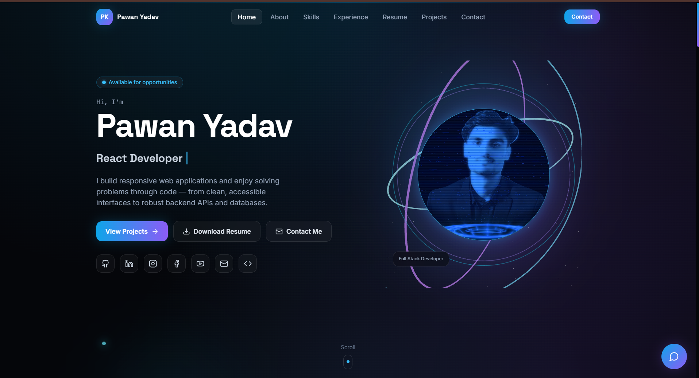
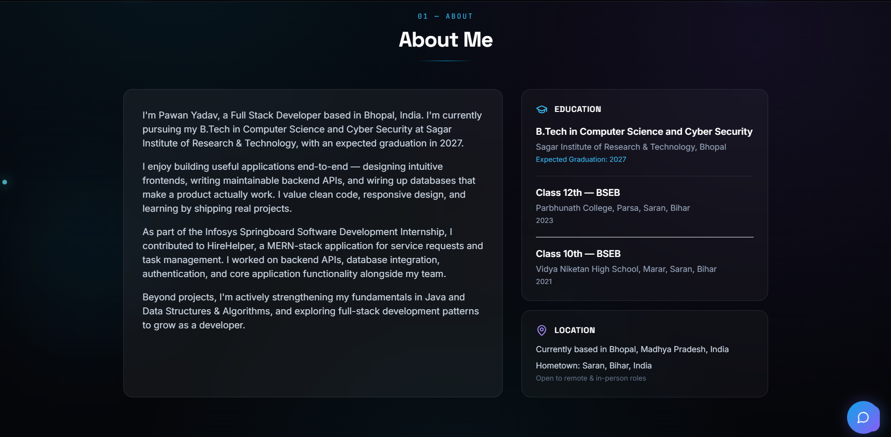
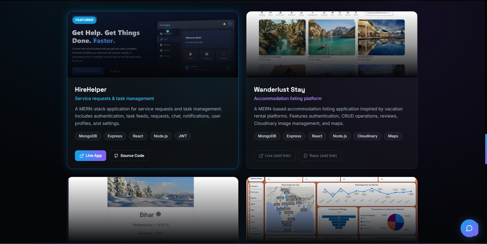
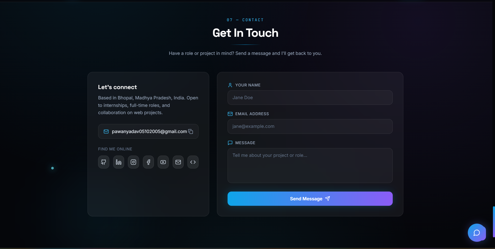

# Pawan Yadav — Full Stack Developer Portfolio

A modern, responsive developer portfolio showcasing my skills, projects, education, internship experience, and contact information.

## 📸 Portfolio Preview

### Home


### About & Education


### Projects


### Contact


## 🌐 Live Demo

- **Portfolio:** YOUR_DEPLOYED_PORTFOLIO_URL
- **GitHub Repository:** YOUR_GITHUB_REPOSITORY_URL

## ✨ Features

- Responsive design for mobile, tablet, and desktop.
- Animated hero section with rotating developer roles.
- Personal introduction and social profile links.
- Education details, including B.Tech, Class 12, and Class 10.
- Technical skills and internship experience.
- Projects with technology details and demo links.
- Resume download option.
- Contact form with backend API integration.
- MongoDB database integration for contact messages.
- Email notifications through Nodemailer.
- Form validation and submission feedback.

## 🛠️ Tech Stack

### Frontend
- React
- TypeScript
- Vite
- Tailwind CSS
- Framer Motion
- Lucide React

### Backend
- Node.js
- Express.js
- MongoDB
- Mongoose
- Nodemailer

### Tools & Deployment
- Git and GitHub
- VS Code
- Vercel for the frontend
- A backend hosting service configured for the API

## 🚀 Run Locally

### Prerequisites

- Node.js and npm
- MongoDB Atlas account or a local MongoDB instance
- Gmail App Password if email notifications are enabled

### 1. Clone the repository

```bash
git clone YOUR_GITHUB_REPOSITORY_URL
cd My-portfolio-main
```

### 2. Install frontend dependencies

```bash
npm install
```

Create a `.env` file in the project root:

```env
VITE_API_URL=http://localhost:5000
```

Start the frontend:

```bash
npm run dev
```

### 3. Configure the backend

Open a separate terminal:

```bash
cd server
npm install
```

Create `server/.env`:

```env
PORT=5000
MONGODB_URI=your_mongodb_connection_string
EMAIL_USER=your_gmail_address
EMAIL_APP_PASSWORD=your_gmail_app_password
CONTACT_TO_EMAIL=your_destination_email
CLIENT_ORIGIN=http://localhost:5173
```

Replace the example values with your own credentials. Never commit real passwords or connection strings.

Start the backend:

```bash
npm run dev
```

The frontend normally runs at `http://localhost:5173` and the backend at `http://localhost:5000`.

## 📂 Project Structure

```text
My-portfolio-main/
├── public/
├── src/
│   ├── components/
│   ├── data/
│   ├── lib/
│   └── sections/
├── server/
│   ├── server.js
│   └── package.json
├── docs/
│   └── screenshots/
├── .gitignore
├── package.json
└── README.md
```

## 👨‍💻 About Me

I'm Pawan Yadav, a B.Tech student in Computer Science and Cyber Security at Sagar Institute of Research & Technology, Bhopal. I enjoy building full-stack web applications and improving my skills in React, Node.js, databases, Java, and Data Structures & Algorithms.

I have completed the Infosys Springboard Software Development Internship, contributing to the HireHelper project.

## 📬 Contact

- **Location:** Bhopal, Madhya Pradesh, India
- **GitHub:** [https://github.com/pawan-yadavk]
- **LinkedIn:** [https://www.linkedin.com/in/pawan-kumar-8a61242a8]

For professional inquiries, please use the contact form on my portfolio website.

---

If you find my work interesting, feel free to explore my projects and connect with me.
